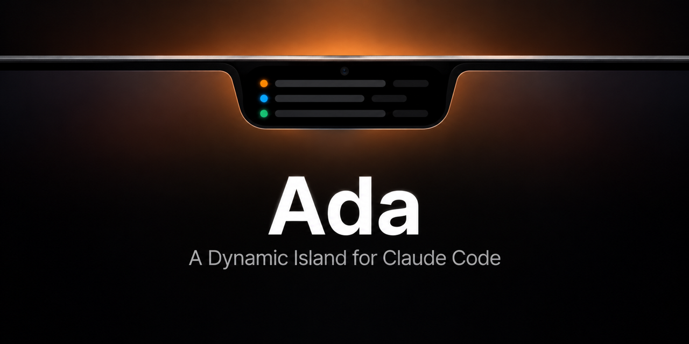

<p align="center"></p>

# Ada

A Dynamic Island for Claude Code on macOS. Ada lives in the notch and shows what your Claude Code sessions are doing: working, waiting for you, or done. You can approve tool calls and answer Claude's questions without switching windows.

Works with sessions in the Claude desktop app (Code tab) and the `claude` CLI.

## Features

- **Session list in the notch.** Click the notch to open it; click outside to close it.
- **Live status** for each chat: the tool it is running (`Bash · npm test`), subagents, context compaction, errors.
- **Approve from the island.** Deny, Allow Once, Allow All (applies Claude's suggested rule), or Bypass.
- **Answer questions.** Claude's multiple-choice questions (`AskUserQuestion`) appear as a card. A single one-choice question is answered with one click; longer ones get a Send button.
- **Review plans.** When Claude leaves plan mode, the plan shows as formatted Markdown. Approve it, or type notes and send it back for another round.
- **Know when you're needed.** If a chat ends its turn on a question for you, it turns orange ("Needs you") with a sound, and shows the question with a button that opens the chat.
- **Jump to the chat.** Click a row to open that exact chat in the Claude desktop app, even if the window is minimized. For CLI sessions, Ada brings the terminal to the front.
- **Plan usage.** Shows your 5-hour session usage and when it resets.
- **Sounds** when a turn finishes or needs you. You can mute them.
- **Sets itself up.** On first launch Ada adds its hooks to Claude Code; there is nothing to configure.
- **Light.** Native Swift, no Electron. Under 1% CPU while sessions run, about 50 MB of memory.

## Requirements

- macOS 14 or later. A Mac with a notch looks best, but Ada also works without one.
- Claude Code, either the desktop app or the CLI.
- To build from source: Swift 5.9+ (Xcode or the Command Line Tools).

## Install

### Download

1. Download `Ada-<version>.zip` from the [latest release](https://github.com/volkankahraman/ada/releases/latest) and unzip it.
2. Move `Ada.app` to `~/Applications` (or `/Applications`) and open it.
3. Ada is not notarized yet, so macOS blocks the first launch. Open System Settings → Privacy & Security, scroll down, and click **Open Anyway** next to Ada. Or run:

   ```sh
   xattr -dr com.apple.quarantine ~/Applications/Ada.app
   ```

### Build from source

```sh
git clone https://github.com/volkankahraman/ada.git
cd ada
./build.sh                       # builds build/Ada.app
cp -R build/Ada.app ~/Applications/
open ~/Applications/Ada.app
```

That's it. On launch Ada copies its hook to `~/.ada/hook.sh` and adds its hooks to `~/.claude/settings.json`, keeping everything else in that file. It backs the file up to `settings.json.bak-ada` before any change and leaves it alone when the hooks are already current. Desktop sessions pick up the hooks right away; a CLI session picks them up when it starts.

To start Ada at login, add `~/Applications/Ada.app` under System Settings → General → Login Items.

### Uninstall

Quit Ada first (it re-adds its hooks on launch), then:

```sh
~/Applications/Ada.app/Contents/MacOS/Ada --uninstall-hooks ~/.claude/settings.json ~/.ada/hook.sh
rm -rf ~/Applications/Ada.app ~/.ada
```

## How it works

```
Claude Code ──hook──> ~/.ada/hook.sh ──curl --unix-socket──> Ada.app
            <─────── decision JSON (approvals, answers) ──────┘
```

- Every hook event is posted to a unix socket at `~/.ada/ada.sock`. Only your user can open it (mode `0600`).
- `PermissionRequest` hooks wait until you click something on the island. If you answer in Claude instead, Ada notices that the hook went away and drops the card.
- If Ada is not running, the hook exits at once and Claude Code behaves as if there were no hook.

## Usage bar and your Claude login

The usage bar calls Claude's OAuth usage endpoint with the login that Claude Code keeps in the macOS keychain (`Claude Code-credentials`). When that access token expires, Ada refreshes it and writes the new token back to the same keychain item, the same way Claude Code does. Your login never leaves your Mac except in requests to Anthropic.

This uses undocumented endpoints that can change without notice. If the bar shows `Login expired`, run `claude auth login` once.

## Project layout

| Path | What it does |
| --- | --- |
| `Sources/Server.swift` | Minimal HTTP over a unix socket |
| `Sources/Store.swift` | Session state and hook decisions |
| `Sources/Views.swift` | Notch shape, session rows, approval and question cards |
| `Sources/Usage.swift` | Plan usage and keychain token refresh |
| `Sources/main.swift` | Notch panel, click handling, timers |
| `Sources/Setup.swift` | Adds or removes the hooks in `~/.claude/settings.json` |
| `hook.sh` | Hook entry point that Claude Code runs |

## License

MIT. Ada is not affiliated with Anthropic.
